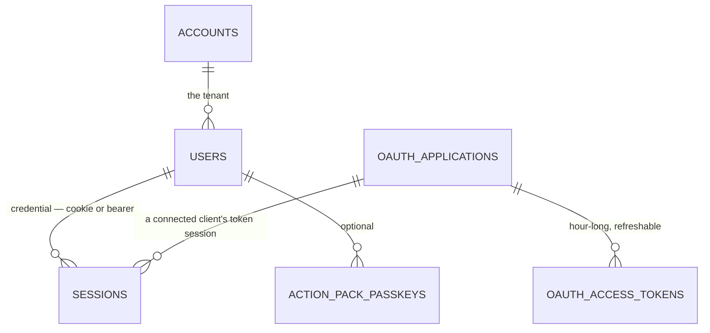
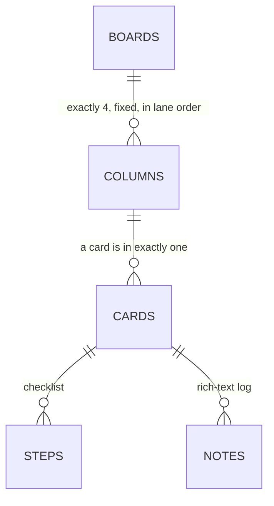
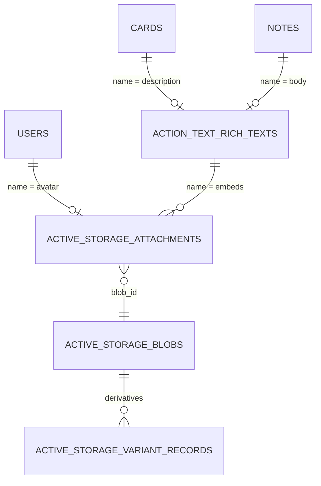
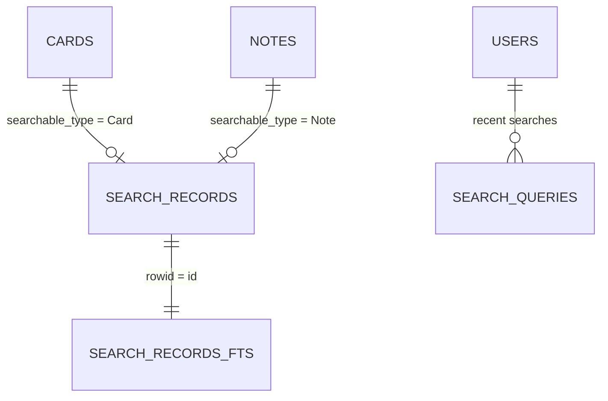

# Mudda — Entity Relationship Diagram

The schema of `db/schema_sqlite.rb` (version `2026_10_14_000001`) and the associations declared
in `app/models/`. Update it with every migration. What the records *do* (the card lifecycle,
sessions and tokens, search) is in [AGENTS.md](AGENTS.md).

- **There are no database-level foreign keys.** Every relationship below is enforced by Active
  Record alone. Nothing at the storage layer prevents an orphaned id, which is why, for example,
  `Card::Triageable#column_on_its_board` validates that a card's lane is on its board.
- **Every key is a plain autoincrementing integer**, so `SELECT` prints the same ids the app and
  the API use. `cards.number` is not a key: it is a per-board sequence drawn from
  `boards.cards_count`, unique only within its board.

---

## Complete diagram

```mermaid
erDiagram
    ACCOUNTS ||--o{ USERS : "has_many dependent-destroy"
    ACCOUNTS ||--o{ BOARDS : "has_many dependent-destroy"

    USERS ||--o{ SESSIONS : "has_many dependent-destroy — browser or token"
    USERS ||--o{ ACTION_PACK_PASSKEYS : "has_passkeys dependent-destroy, polymorphic holder"
    USERS ||--o| USER_SETTINGS : "has_one dependent-destroy"
    USERS ||--o{ SEARCH_QUERIES : "has_many dependent-destroy"
    USERS ||--o{ BOARDS : "creator_id"
    USERS ||--o{ CARDS : "creator_id"
    USERS ||--o{ NOTES : "creator_id dependent-destroy"
    USERS ||--o{ EVENTS : "creator_id"
    USERS ||--o{ OAUTH_ACCESS_GRANTS : "resource_owner_id"
    USERS ||--o{ OAUTH_ACCESS_TOKENS : "resource_owner_id"

    OAUTH_APPLICATIONS ||--o{ SESSIONS : "oauth_application_id — one per user and client"
    OAUTH_APPLICATIONS ||--o{ OAUTH_ACCESS_GRANTS : "application_id"
    OAUTH_APPLICATIONS ||--o{ OAUTH_ACCESS_TOKENS : "application_id"

    BOARDS ||--o{ COLUMNS : "has_many dependent-destroy — always 4"
    BOARDS ||--o{ CARDS : "has_many dependent-destroy"

    COLUMNS ||--o{ CARDS : "a card is in exactly one"

    CARDS ||--o{ NOTES : "has_many dependent-destroy"
    CARDS ||--o{ STEPS : "has_many dependent-destroy"
    CARDS ||--o{ SEARCH_RECORDS : "card_id — its own row and its notes' rows"
    CARDS ||--o| ACTION_TEXT_RICH_TEXTS : "has_rich_text description"
    CARDS ||--o{ EVENTS : "polymorphic eventable"

    NOTES ||--o| ACTION_TEXT_RICH_TEXTS : "has_rich_text body"
    NOTES ||--o{ EVENTS : "polymorphic eventable"

    ACTIVE_STORAGE_BLOBS ||--o{ ACTIVE_STORAGE_ATTACHMENTS : "blob_id"
    ACTIVE_STORAGE_BLOBS ||--o{ ACTIVE_STORAGE_VARIANT_RECORDS : "blob_id"
    SEARCH_RECORDS ||--|| SEARCH_RECORDS_FTS : "rowid = id"

    ACCOUNTS {
        integer id PK
        string name "limit 255 NOT NULL"
        integer cards_created_count "NOT NULL DEFAULT 0 — only goes up (MUDDA_CARD_LIMIT)"
        datetime created_at "NOT NULL"
        datetime updated_at "NOT NULL"
    }

    USERS {
        integer id PK
        bigint account_id FK "NOT NULL"
        string email_address UK "limit 255 NOT NULL"
        string name "limit 255 NOT NULL"
        boolean active "default true NOT NULL"
        datetime verified_at "nullable"
        datetime created_at "NOT NULL"
        datetime updated_at "NOT NULL"
    }

    USER_SETTINGS {
        integer id PK
        bigint user_id FK "NOT NULL UNIQUE — enforces has_one"
        string locale "limit 255 nullable — NULL follows the browser"
        string timezone_name "limit 255 nullable"
        datetime created_at "NOT NULL"
        datetime updated_at "NOT NULL"
    }

    SESSIONS {
        integer id PK
        bigint user_id FK "NOT NULL"
        string kind "limit 255 default browser NOT NULL"
        string label "limit 255 — present iff kind is token"
        string scopes "limit 255 — space-separated; present iff kind is token"
        bigint oauth_application_id FK "set only on an OAuth client's token session"
        string ip_address "limit 255"
        string user_agent "limit 4096"
        datetime created_at "NOT NULL — no expiry column"
        datetime updated_at "NOT NULL"
    }

    ACTION_PACK_PASSKEYS {
        integer id PK
        bigint holder_id FK "NOT NULL — always a User"
        string holder_type "limit 255 NOT NULL"
        string credential_id UK "limit 255 NOT NULL"
        binary public_key "NOT NULL"
        integer sign_count "default 0 NOT NULL"
        string aaguid "limit 255"
        boolean backed_up "nullable"
        string name "limit 255"
        text transports "limit 65535"
        datetime created_at "NOT NULL"
        datetime updated_at "NOT NULL"
    }

    OAUTH_APPLICATIONS {
        integer id PK
        string name "limit 255 NOT NULL — the client's own name"
        string uid UK "limit 255 NOT NULL — the client_id"
        string secret "limit 255 NOT NULL — hashed"
        text redirect_uri "limit 65535 NOT NULL"
        string scopes "limit 255 default '' NOT NULL"
        boolean confidential "default true NOT NULL"
        datetime created_at "NOT NULL"
        datetime updated_at "NOT NULL"
    }

    OAUTH_ACCESS_GRANTS {
        integer id PK
        bigint resource_owner_id FK "NOT NULL — a users.id"
        bigint application_id FK "NOT NULL"
        string token UK "limit 255 NOT NULL — the authorization code, hashed"
        integer expires_in "NOT NULL"
        text redirect_uri "limit 65535 NOT NULL"
        string scopes "limit 255 default '' NOT NULL"
        string code_challenge "limit 255 — PKCE"
        string code_challenge_method "limit 255 — PKCE, always S256"
        datetime revoked_at "nullable"
        datetime created_at "NOT NULL — no updated_at"
    }

    OAUTH_ACCESS_TOKENS {
        integer id PK
        bigint resource_owner_id FK "nullable — a users.id"
        bigint application_id FK "NOT NULL"
        string token UK "limit 255 NOT NULL — hashed"
        string refresh_token UK "limit 255 — hashed"
        string previous_refresh_token "limit 255 default '' NOT NULL"
        integer expires_in
        string scopes "limit 255"
        datetime revoked_at "nullable"
        datetime created_at "NOT NULL — no updated_at"
    }

    BOARDS {
        integer id PK
        bigint account_id FK "NOT NULL"
        bigint creator_id FK "NOT NULL — User"
        string name "limit 255 NOT NULL"
        bigint cards_count "default 0 NOT NULL — source of Card#number"
        datetime created_at "NOT NULL"
        datetime updated_at "NOT NULL"
    }

    COLUMNS {
        integer id PK
        bigint board_id FK "NOT NULL"
        string name "limit 255 NOT NULL"
        integer position "default 0 NOT NULL — ascending in lane order"
        string color "limit 255 NOT NULL — the only editable field"
        datetime created_at "NOT NULL"
        datetime updated_at "NOT NULL"
    }

    CARDS {
        integer id PK
        bigint board_id FK "NOT NULL"
        bigint column_id FK "NOT NULL — the card's lifecycle"
        bigint creator_id FK "NOT NULL — User"
        bigint number "NOT NULL"
        string title "limit 255 nullable — the model fills in a default"
        date due_on "nullable — the model requires it in Todo and Doing"
        boolean golden "default false NOT NULL"
        datetime last_active_at "NOT NULL"
        datetime created_at "NOT NULL"
        datetime updated_at "NOT NULL"
    }

    STEPS {
        integer id PK
        bigint card_id FK "NOT NULL"
        text content "limit 65535 NOT NULL"
        boolean completed "default false NOT NULL"
        datetime created_at "NOT NULL — there is no position column"
        datetime updated_at "NOT NULL"
    }

    NOTES {
        integer id PK
        bigint card_id FK "NOT NULL"
        bigint creator_id FK "NOT NULL"
        datetime created_at "NOT NULL"
        datetime updated_at "NOT NULL"
    }

    EVENTS {
        integer id PK
        bigint creator_id FK "NOT NULL — User"
        bigint eventable_id FK "NOT NULL"
        string eventable_type "limit 255 NOT NULL — Card or Note"
        string action "limit 255 NOT NULL"
        string agent_name "limit 255 — the acting token's label; null from a browser"
        json particulars "default json_object()"
        datetime created_at "NOT NULL"
        datetime updated_at "NOT NULL"
    }

    SEARCH_QUERIES {
        integer id PK
        bigint user_id FK "NOT NULL"
        string terms "limit 2000 NOT NULL"
        datetime created_at "NOT NULL"
        datetime updated_at "NOT NULL"
    }

    SEARCH_RECORDS {
        integer id PK "the FTS rowid"
        bigint card_id FK "NOT NULL — the card, or the note's card"
        bigint searchable_id FK "NOT NULL"
        string searchable_type "limit 255 NOT NULL — Card or Note"
        string title "limit 255 nullable — as written"
        text content "limit 65535 nullable — as written"
        datetime created_at "NOT NULL — copied from the card or note; no updated_at"
    }

    SEARCH_RECORDS_FTS {
        integer rowid PK
        text title "fts5, normalized"
        text content "fts5, normalized"
    }

    ACTION_TEXT_RICH_TEXTS {
        integer id PK
        bigint record_id FK "NOT NULL"
        string record_type "limit 255 NOT NULL — Card or Note"
        string name "limit 255 NOT NULL"
        text body "limit 4294967295 — card and note text lives here"
        datetime created_at "NOT NULL"
        datetime updated_at "NOT NULL"
    }

    ACTIVE_STORAGE_ATTACHMENTS {
        integer id PK
        bigint record_id FK "NOT NULL"
        string record_type "limit 255 NOT NULL"
        string name "limit 255 NOT NULL"
        bigint blob_id FK "NOT NULL"
        datetime created_at "NOT NULL"
    }

    ACTIVE_STORAGE_BLOBS {
        integer id PK
        string key UK "limit 255 NOT NULL"
        string filename "limit 255 NOT NULL"
        string content_type "limit 255"
        text metadata "limit 65535"
        string service_name "limit 255 NOT NULL — local disk only"
        bigint byte_size "NOT NULL"
        string checksum "limit 255"
        datetime created_at "NOT NULL"
    }

    ACTIVE_STORAGE_VARIANT_RECORDS {
        integer id PK
        bigint blob_id FK "NOT NULL"
        string variation_digest "limit 255 NOT NULL"
    }
```



---

## Focused views

### Sessions and OAuth



There is **no password column anywhere**: the owner's password lives only in the environment
(see [AGENTS.md → Authentication](AGENTS.md#authentication)). A minted token's expiry is signed
into the token itself, and an OAuth session's is reckoned from its client's latest access
token, so neither needs a column. `oauth_applications`, `oauth_access_grants`, and
`oauth_access_tokens` are Doorkeeper's, in its standard shape plus the PKCE columns.

### Card lifecycle



`column_id` is the only lifecycle state; there are no closed or backlog tables (see
[AGENTS.md → Card Lifecycle](AGENTS.md#card-lifecycle-fixed-columns)). `position` only orders a
board's lanes. Its values aren't contiguous on boards that once had a Triage lane, which
`20261011000000_fold_triage_into_backlog` folded into Backlog.

### Text and attachments

Card and note **bodies are not in their own tables**, which trips up every raw-SQL query:



```sql
select c.board_id, c.number, c.title, rt.body
from cards c
left join action_text_rich_texts rt
  on rt.record_id = c.id and rt.record_type = 'Card' and rt.name = 'description';
```

### Search



`search_records` holds one row per card and per note. **Every row carries `card_id`**, so a
note's match resolves to its card. Neither `search_records` nor `events` keeps a copy of the
board: both reach it through their card. `search_records_fts` is an FTS5 virtual table
(`tokenize='porter'`) joined by rowid, holding the text as `Search::Normalizer` folds it, while
`search_records` keeps it as written. Ignore its FTS5 shadow tables (`_config`, `_content`,
`_data`, `_docsize`, `_idx`).

---

## Index reference

| Table | Index | Columns | Unique |
|---|---|---|:---:|
| `users` | `index_users_on_email_address` | `email_address` | ✓ |
| `users` | `index_users_on_account_id` | `account_id` | |
| `user_settings` | `index_user_settings_on_user_id` | `user_id` | ✓ |
| `sessions` | `index_sessions_on_user_id_and_kind` | `user_id, kind` | |
| `sessions` | `index_sessions_on_oauth_application_id` | `oauth_application_id` | |
| `sessions` | `index_sessions_on_user_id_and_oauth_application_id` | `user_id, oauth_application_id` | ✓ (where `oauth_application_id` is set) |
| `oauth_applications` | `..._on_uid` | `uid` | ✓ |
| `oauth_access_grants` | `..._on_token` / `..._on_resource_owner_id` / `..._on_application_id` | `token` / `resource_owner_id` / `application_id` | ✓ / / |
| `oauth_access_tokens` | `..._on_token` / `..._on_refresh_token` | `token` / `refresh_token` | ✓ / ✓ |
| `oauth_access_tokens` | `..._on_resource_owner_id` / `..._on_application_id` | `resource_owner_id` / `application_id` | |
| `action_pack_passkeys` | `..._on_credential_id` | `credential_id` | ✓ |
| `action_pack_passkeys` | `..._on_holder_type_and_holder_id` | `holder_type, holder_id` | |
| `boards` | `..._on_account_id` / `..._on_creator_id` | `account_id` / `creator_id` | |
| `columns` | `index_columns_on_board_id_and_position` | `board_id, position` | |
| `cards` | `index_cards_on_board_id_and_number` | `board_id, number` | ✓ |
| `cards` | `..._on_board_id_and_last_active_at` | `board_id, last_active_at` | |
| `cards` | `..._on_column_id` / `..._on_creator_id` | `column_id` / `creator_id` | |
| `steps` | `index_steps_on_card_id_and_completed` | `card_id, completed` | |
| `notes` | `..._on_card_id` / `..._on_creator_id` | `card_id` / `creator_id` | |
| `events` | `index_events_on_eventable` | `eventable_type, eventable_id` | |
| `events` | `..._on_creator_id` | `creator_id` | |
| `search_queries` | `..._on_user_id_and_updated_at` | `user_id, updated_at` | ✓ |
| `search_queries` | `..._on_user_id_and_terms` | `user_id, terms` | |
| `search_records` | `..._on_searchable_type_and_searchable_id` | `searchable_type, searchable_id` | ✓ |
| `search_records` | `..._on_card_id` | `card_id` | |
| `action_text_rich_texts` | `index_action_text_rich_texts_uniqueness` | `record_type, record_id, name` | ✓ |
| `active_storage_blobs` | `..._on_key` | `key` | ✓ |
| `active_storage_attachments` | `..._uniqueness` | `record_type, record_id, name, blob_id` | ✓ |
| `active_storage_attachments` | `..._on_blob_id` | `blob_id` | |
| `active_storage_variant_records` | `..._uniqueness` | `blob_id, variation_digest` | ✓ |

---

## Enumerated values

**`sessions.kind`**: `browser` (the default, a cookie) · `token` (a script, agent, or OAuth client).

**`sessions.scopes`**: space-separated, any of `read` · `write` · `delete`. Tokens default to `read write`.

**`user_settings.locale`**: `en` · `ar` · `NULL` (follow the browser).

**`columns.name`**: `Backlog` · `Todo` · `Doing` · `Done`, created together by
`Board::Triageable` on every board, in that order.

**`columns.color`**: a CSS value from `Color::COLORS`: `var(--color-card-default)` or
`var(--color-card-1)` through `var(--color-card-8)`. New lanes get card-2, card-3, card-5, and
card-4 in lane order.

**`events.action`**: written by `Eventable#track_event` as `<type>_<action>`:

| Action | Eventable | `particulars` | Written by |
|---|---|---|---|
| `card_created` | Card | `{}` | `Card::Eventable`, on create |
| `card_triaged` | Card | `{column}` (the lane's name) | `Card::Triageable`, on any change of `column_id` after create, a move to another board's Backlog included |
| `card_title_changed` | Card | `{old_title, new_title}` | `Card::Eventable` |
| `card_board_changed` | Card | `{old_board, new_board}` (board names) | `Card#track_board_change` |
| `note_created` | Note | `{}` | `Note::Eventable` |

**`action_text_rich_texts.name`**: `description` (on Card) · `body` (on Note).

**`active_storage_attachments`** (`record_type`: `name`): `User`: `avatar` ·
`ActionText::RichText`: `embeds` · `ActiveStorage::VariantRecord`: `image` (a processed variant
of either).

---

## Infrastructure tables

These don't appear in `db/schema_sqlite.rb`:

- **`schema_migrations`** holds one `version` row per applied migration; `db:migrate` compares
  it against `db/migrate/`.
- **`ar_internal_metadata`** holds the `environment` row that makes `db:drop` and `db:reset`
  refuse to run against production, plus the `schema_sha1`. Never edit it.
- **`sqlite_sequence`** holds the autoincrement high-water mark for each table. SQLite maintains
  it, and nothing in the app reads it.

## Regenerating

```bash
# schema (after a migration)
docker compose exec web bin/rails db:migrate     # rewrites db/schema_sqlite.rb

# check a table against the live database
docker compose exec -T web sqlite3 storage/development.sqlite3 ".schema --indent cards"
```
